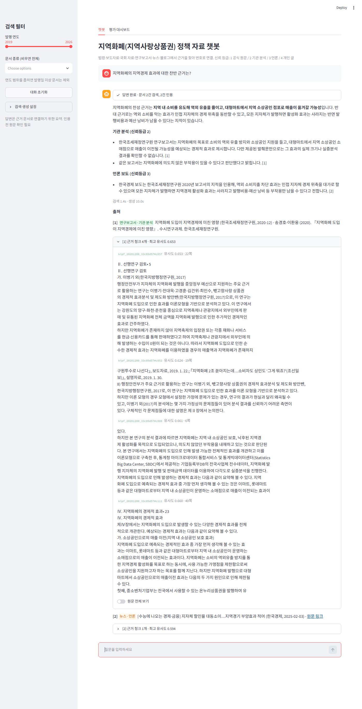
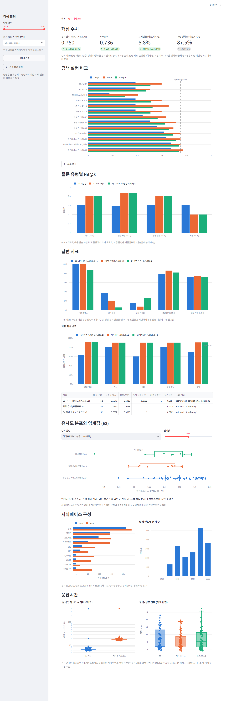

# 지역화폐(지역사랑상품권) 정책 자료 RAG 챗봇

기초자치단체 지역경제과 지역화폐 담당 주무관을 위한 근거 검색 챗봇. 법령·보도자료·국회 자료·연구보고서·뉴스·블로그에서 근거를 찾아 번호 출처와 신뢰등급(1 공식 원문 / 2 기관 분석 / 3 언론 / 4 개인 글)으로 연결하고, 근거가 없으면 답변을 거절함.

- 결과 리포트: [report/report.md](report/report.md)
- 진행 계획과 의사결정 기록: [docs/masterplan.md](docs/masterplan.md)
- 명세: [docs/data_spec.md](docs/data_spec.md) (데이터·DB·평가 형식), [docs/api_spec.md](docs/api_spec.md) (외부 API, 검색기·평가·체인 인터페이스)

| 챗봇 | 평가 대시보드 |
|---|---|
|  |  |

## 주요 수치 (답변 가능 52문항 + 답변 불가 8문항)

| 지표 | 기준선 | 최종 |
|---|---:|---:|
| 문서 단위 Hit@3 | 0.596 | 0.750 |
| MRR@10 | 0.506 | 0.736 |
| 답변 정확+부분 | 69.2% | 90.4% |
| 출처 정확성 | 97.9% | 100% |
| 거절 정확도 / 오거절률 | 100% / 36.5% | 100% / 7.7% |

최종 설정: 청킹 A(500자/100, 제목 prefix), `text-embedding-3-small`, 하이브리드 검색(벡터 + BM25 RRF) + 신뢰등급 1~2 가산점 0.04, 프롬프트 v2, 생성 `gpt-6-luna`

## 디렉터리 구조

```
mini-pjt-3-kevin/
├── config.py            # 경로, 모델명, 청킹 프리셋, 검색·생성 설정의 단일 설정원
├── collector/           # ① 수집 계층: 제공 CSV, 정책브리핑 크롤링, 법령·열린국회정보·네이버 API, 수동 자료 등록
├── indexer/             # ② 인덱싱 계층: 파싱·정제·관련도·중복 → 원문 DB, 청킹, 임베딩·Chroma 적재, 검증, BM25
├── store/               # ③ 저장 계층: chroma/ (벡터 DB), docs.db (원문 DB), bm25/ (git 제외, 재생성)
├── rag/                 # 검색·생성: retriever.py, bm25.py, chain.py (build_chain), prompts.py, docstore.py (읽기 전용)
├── app/                 # ④ Streamlit 앱: main.py, chat.py (챗), dashboard.py (평가 대시보드). rag/만 import
├── eval/                # 평가셋 eval_set.jsonl, 하네스 run_eval.py, 채점 집계 grade.py, 실험 결과 results/
├── data/                # manifest.jsonl, manual_sources.csv, quality/ (git 추적) / news_csv_5y, raw, interim (git 제외)
├── notebooks/eda.ipynb  # 제공 뉴스 EDA
├── docs/                # 계획·명세·EDA·소스 접근성 문서
└── report/              # 결과 리포트와 스크린샷
```

- 계층 규칙: `app/`은 `rag/`만 import, `rag/`는 Chroma·원문 DB 읽기와 쿼리 임베딩만 수행 (문서 임베딩·쓰기 없음). 챗봇과 평가 하네스가 같은 `rag.chain.build_chain(cfg)` 호출
- 계층 분리 검증: `collector/`·`indexer/`가 없는 복사본에서 챗봇·대시보드 구동 확인 (리포트 3-1)

## 환경 준비

Python 3.14 기준.

```bash
python -m venv .venv
```

```bash
.venv/Scripts/python -m pip install -r requirements.txt
```

`.env.example`을 `.env`로 복사한 뒤 키 값 입력 (`.env`는 `.gitignore` 등록).

| 키 | 용도 | 필요 계층 |
|---|---|---|
| `OPENAI_API_KEY` | 임베딩·생성 | indexer, rag, app, eval |
| `NAVER_CLIENT_ID`, `NAVER_CLIENT_SECRET` | 블로그 요약문 수집 (NAVER API HUB) | collector |
| `LAW_OPEN_API_OC` | 법령 원문 | collector |
| `ASSEMBLY_API_KEY` | 열린국회정보 의안 목록 | collector |

## 실행 순서

### 0. 입력 데이터 배치

- 제공 뉴스 CSV: `data/news_csv_5y/` (git 제외)
- 수동 다운로드 PDF: `data/raw/reports/` 에 `data/manual_sources.csv`의 `file` 이름으로 저장 (robots.txt 차단·수동 확보 자료, 서지는 CSV에 기록)

### 1. 수집 계층 (배치)

```bash
.venv/Scripts/python -m collector all
```

- 개별 실행: `provided`(제공 CSV), `manual`(수동 자료 등록), `law`, `assembly`, `naver`, `korea_kr` 중 선택 (예: `python -m collector provided korea_kr`)
- 결과: `data/raw/`, `data/manifest.jsonl` (모든 직접 수집 문서의 url·collected_at)
- 재실행: manifest에 등록된 문서는 다시 등록하지 않고, 원본 파일이 없는 문서(저장소를 새로 받은 환경)는 원본만 복원. 네이버 검색 응답과 의안 목록은 파일이 이미 있으면 다시 호출하지 않음 (갱신하려면 해당 파일 삭제)
- 제약: 네이버 검색 응답을 새로 받으면 검색 결과가 수집 당시와 달라 블로그 구성이 바뀜 → 리포트 수치의 완전한 재현에는 수집 당시의 `data/raw/naver/`가 필요

### 2. 인덱싱 계층 (배치)

```bash
.venv/Scripts/python -m indexer docs
```

```bash
.venv/Scripts/python -m indexer chunk --preset A
```

```bash
.venv/Scripts/python -m indexer embed --preset A
```

```bash
.venv/Scripts/python -m indexer verify
```

```bash
.venv/Scripts/python -m indexer bm25 --collection kb_A_te3s
```

- `docs`: 파싱·정제·관련도·중복 처리 → `store/docs.db`
- `chunk` / `embed`: 청킹과 임베딩·Chroma 적재 (`store/chroma/`, 컬렉션 `kb_A_te3s`, 약 25분). 중단 후 재실행하면 이어서 적재하고, 텍스트가 바뀐 청크만 다시 임베딩
- `docs`를 다시 실행하면 `docs.db`를 새로 만들므로 `chunk`부터 다시 실행
- `verify`: 포함 문서 분포, 청크 길이 분포, chunks 테이블과 Chroma 적재 수·텍스트 일치, 저장 벡터 자기 검색 점검 (`data/interim/verify_{collection}.json`)
- `bm25`: 하이브리드 검색용 BM25 인덱스 (`store/bm25/`, 약 80초)
- 비교 실험용 컬렉션: `--preset B` (청킹 B), `--preset A --no-title` (제목 prefix 제거)

### 3. 챗봇 (조회 전용)

```bash
.venv/Scripts/python -m streamlit run app/main.py
```

- 필요 파일: `store/` (chroma, docs.db, bm25), `.env`의 `OPENAI_API_KEY`. `collector/`·`indexer/` 불필요
- 탭: 챗봇 (멀티턴, 기간·문서 종류 필터, 번호 출처, 근거 청크, 원문 전체 보기) / 평가 대시보드 (`eval/results/` 읽기)

### 4. 평가

```bash
.venv/Scripts/python -m eval.run_eval --tag baseline --retrieval-only --hybrid 0 --tier-bonus none
```

```bash
.venv/Scripts/python -m eval.run_eval --tag final
```

```bash
.venv/Scripts/python -m eval.grade eval/results/<결과 폴더>
```

- `--retrieval-only`: LLM 호출 없이 Hit@k·MRR (검색 실험용). 생략하면 full 모드 (문항당 3회 생성, 채점 시트 `grade_sheet.csv` 생성)
- 지정하지 않은 옵션은 `config.py` 기본값(챗봇과 동일). 실험 변수: `--hybrid`, `--tier-bonus`, `--prompt-version`, `--collection` 등 (`--help`)
- 채점: `grade_sheet.csv`의 `accuracy`(1/0.5/0), `citation_correct`, `refusal_correct`, `failure_layer` 기입 후 `eval.grade` 실행 → `graded_summary.json` (대시보드에 표시)
- 결과 형식: `eval/results/{YYYYMMDD-HHMM}_{tag}/` 의 `config.json`, `per_question.jsonl`, `summary.json`

## 데이터 출처와 이용 조건

- 제공 데이터: 교육 과정 제공 뉴스 CSV (지역화폐 키워드, 2021-10-16 ~ 2026-10-16)
- 정책브리핑 보도자료: 공공누리 제1유형(출처표시), 텍스트만 수집
- 법령: 국가법령정보센터 Open API / 의안: 열린국회정보 Open API
- 연구보고서·예산 분석·국회 문서 PDF: 각 기관 공개 자료를 수동 다운로드 (서지 `data/manual_sources.csv`)
- 블로그: 네이버 검색 API 요약문만 사용 (blog.naver.com robots.txt가 RAG 목적 봇의 본문 접근 금지)
- 소스별 robots.txt 판정: [docs/source_access.md](docs/source_access.md)
