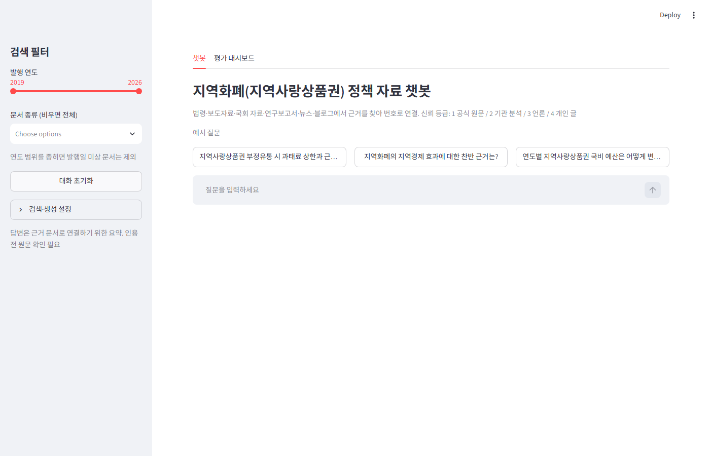
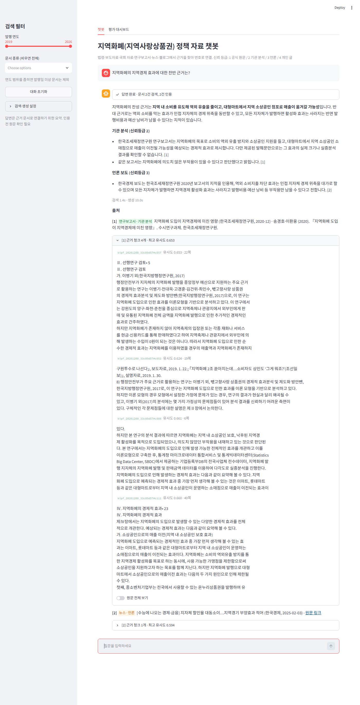
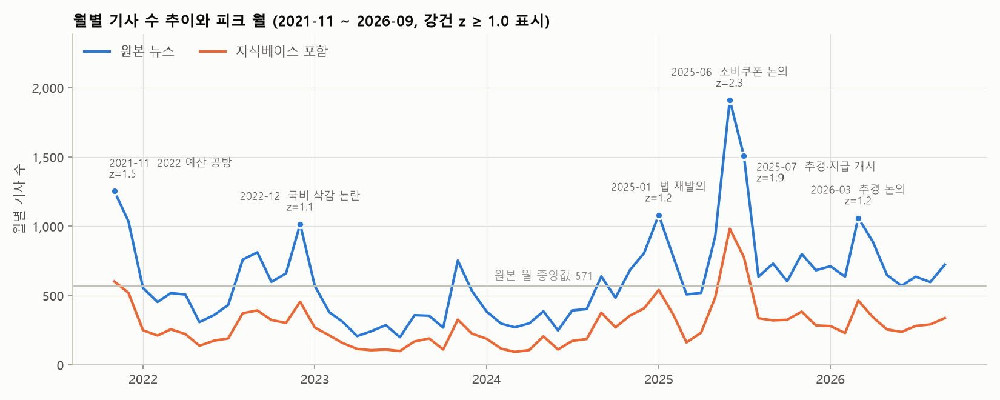
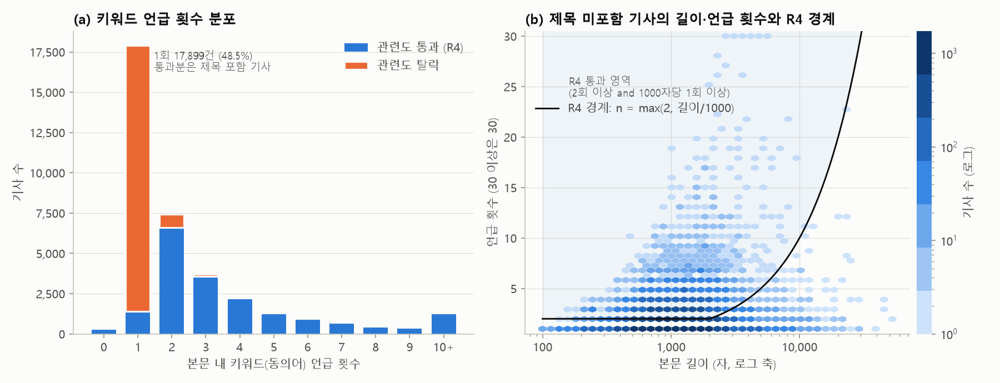
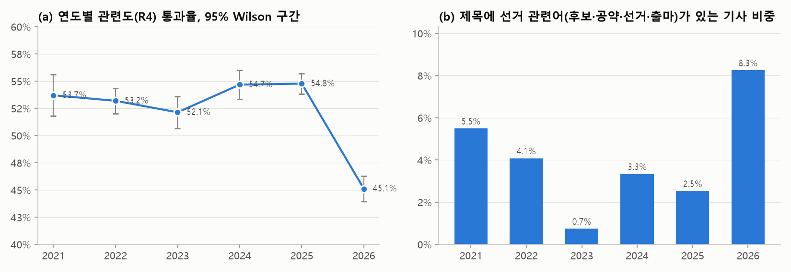
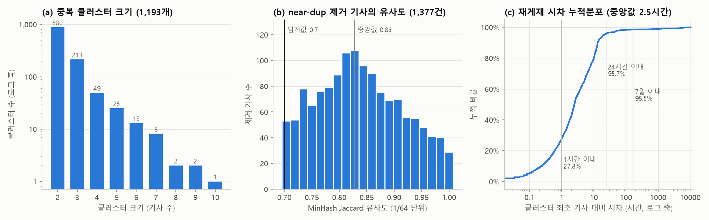
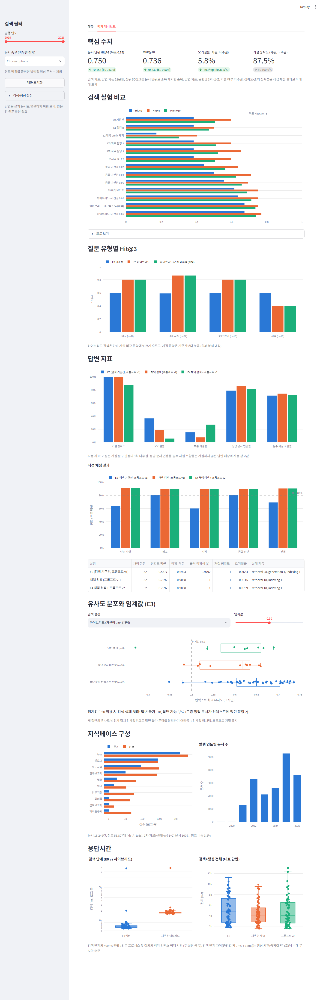
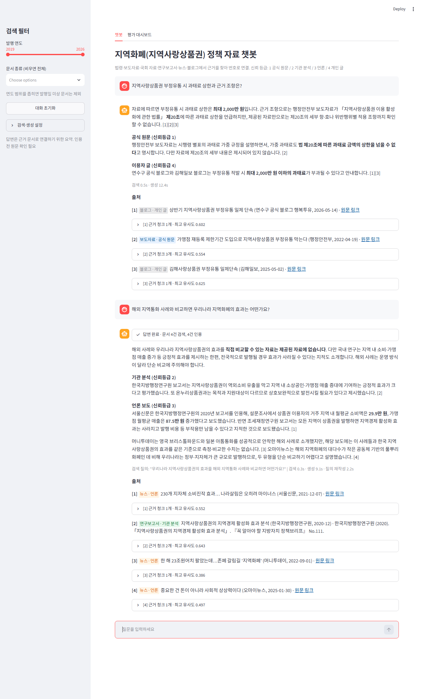

# 지역화폐(지역사랑상품권) 정책 자료 RAG 챗봇 — 결과 리포트

- 과제: 미니프로젝트 3 (개인, 6일)
- 저장소 구조와 실행 순서: [README.md](../README.md)
- 상세 근거 문서: [masterplan.md](../docs/masterplan.md), [eda_findings.md](../docs/eda_findings.md), [source_access.md](../docs/source_access.md), [data_spec.md](../docs/data_spec.md), [api_spec.md](../docs/api_spec.md)

## 요약

| 성공 기준 | 목표 | 기준선 (E0) | 최종 (채택 설정) | 판정 |
|---|---|---:|---:|---|
| 검색 품질: 문서 단위 Hit@3 | ≥ 0.75 | 0.596 | **0.750** | 달성 |
| 검색 품질: MRR@10 | 개선 | 0.506 | **0.736** | 달성 |
| 답변 정확도: 정확+부분 비율 | ≥ 80% | 69.2% | **90.4%** | 달성 |
| 출처 정확성: 인용 [n]이 실제 근거인 비율 | ≥ 90% | 97.9% | **100%** | 달성 |
| 거절 정확도: 답변 불가 문항 거절 비율 | ≥ 90% | 100% | **100%** | 달성 |
| 오거절률: 답변 가능 문항 거절 비율 | ≤ 10% | 36.5% | **7.7%** | 달성 |
| 계층 분리: 인덱서 없이 챗봇 단독 구동 | 통과 | - | 통과 | 달성 |

- 채택 설정: 청킹 A(500자/100), 제목 prefix 포함, `text-embedding-3-small`, **하이브리드 검색(벡터 + BM25 RRF) + 신뢰등급 1~2 가산점 0.04**, 임계값 미적용, **프롬프트 v2**
- 최종 정확도 평균(정확 1 / 부분 0.5 / 오답 0)은 0.558 → 0.769. 남은 실패 19문항 중 18문항이 검색 계층 원인 (8항)
- 신뢰성 판단: 단순 사실·시점 문항은 정확+부분 90% 이상으로 업무 참고 수준이나, 비교 문항의 정확(완전 정답) 비율은 30%에 그쳐 두 대상 중 한쪽만 답하는 경향이 남음. 답변은 반드시 번호 출처의 원문 확인을 전제로 사용해야 함

---

## 1. 시스템 정의

### 1-1. 대상 사용자와 업무 상황

- 대상 사용자: 기초자치단체 지역경제과 지역화폐(지역사랑상품권) 담당 주무관
- 주제 선택 근거: 제공 데이터 5개 그룹 중 공공정책(지역화폐)은 찬반 대립(효과 논쟁, 여야 예산 공방)이 뚜렷하고, 법령·보도자료·국회 자료·국책연구 보고서 등 1차 자료가 공개되어 있어 "양측 근거 제시"와 "출처 신뢰도 구분"을 가장 선명하게 측정 가능
- 업무 상황

| # | 상황 | 필요한 근거 |
|---|---|---|
| 1 | 의회·언론 질의 대응 시 "효과가 있느냐"에 대한 양측 근거 확보 | 연구보고서 (긍정·부정 양측) |
| 2 | 국비 지원 규모·할인율 등 제도 변경 이력 확인 | 보도자료, 예산 분석 |
| 3 | 타 지자체 운영 방식 비교 (발행 규모, 할인율, 가맹점 제한) | 뉴스 개별 문서 종합 |
| 4 | 민원(사용처, 구매 한도, 부정유통) 응대용 근거 확인 | 법령, 업무지침 |

### 1-2. 대표 질문

| 유형 | 대표 질문 | 근거 위치 |
|---|---|---|
| 사실 | 부정유통 시 과태료 상한과 근거 조항은? / 가맹점 등록 제한 기준과 예외는? | 법령·보도자료 |
| 비교 | 부산 동백전과 경기지역화폐의 캐시백·인센티브 차이는? | 뉴스 개별 문서 종합 |
| 시점 | 연도별 국비 예산은 어떻게 변했나? / 지역사랑상품권법 개정(재정지원 의무화) 경과는? | 뉴스 + 보도자료·의안 |
| 종합·판단 | 지역화폐의 지역경제 효과에 대한 찬반 근거는? / 운영대행사 논란의 쟁점은? | 연구보고서 + 뉴스 |
| 답변 불가 | 해외 지역통화와의 비교 / 특정 가맹점 매출 증가율 | 수집 범위 밖 |

### 1-3. 챗봇 화면

| 첫 화면 | 종합·판단 질문 답변 (출처 번호, 신뢰등급별 구분, 근거 청크 펼침) |
|---|---|
|  |  |

- 답변 구성: 결론 1~2문장 → 신뢰등급별(공식 원문 / 기관 분석 / 언론 / 개인 글) 근거 → 확인 불가 항목 명시 → 번호 출처 목록(문서 종류 배지, 발행처, 발행일, 원문 링크 또는 참고문헌 표기) → 근거 청크와 유사도 → 원문 전체 보기
- 사이드바: 발행 연도 범위, 문서 종류 필터. 검색 결과가 없으면 오류 대신 필터 완화 안내

---

## 2. 지식베이스 구성

### 2-1. 문서 탐색(EDA) 결과 — 제공 뉴스 `05_공공정책_키워드_지역화폐`

| 항목 | 결과 |
|---|---|
| 건수·기간 | 36,888건, 2021-10-16 ~ 2026-10-16, 매체 96개 (통신사 3사 23.6%) |
| 연도 편중 | 2025년 10,694건 최다 (민생회복 소비쿠폰), 2021년은 10/16부터라 과소 |
| 본문 길이 | 중앙값 969자, p95 2,745자. 200자 미만 605건(1.6%), 10,000자 초과 157건(토크쇼 녹취 등) |
| 보일러플레이트 | 꼬리말 "기사 섹션 분류 안내" 7,311건(19.8%), 제보·구독 안내 1,650건 → 정규식 절단 |
| 관련도 | 키워드가 본문에 1회만 등장하는 기사 54% (포상금의 지역화폐 지급 등 부수 언급 다수) |
| 중복 | 완전 중복은 적음(본문 해시 중복 625건), 문제의 본체는 near-dup. 대부분 24시간 이내 재게재이며 동일 매체 반복(중복 클러스터의 41%)과 매체 간 재배포가 혼재 (2-1-1) |

### 2-1-1. 심화 통계 분석 — 시계열과 키워드 언급·중복 구조

- 대상: `store/docs.db`의 뉴스 36,887건(원본 36,888건 대비 1건 차이, EDA의 URL 중복 1건과 일치)과 그중 지식베이스 포함 17,327건
- 키워드 언급 횟수는 꼬리말 절단 후 본문 기준 (관련도 판정과 같은 입력). 원본 본문 기준인 2-1 표의 수치(1회 등장 54%)와 차이 존재
- 재현: `python notebooks/eda_stats.py` → `data/interim/eda_stats.json`, `report/images/05~08_eda_*.png`
- 부분 월(2021-10, 2026-10)은 월별 분석에서 제외 (59개월)

#### (1) 시계열: 사건 주도형 변동, 계절성 없음



| 지표 | 값 | 해석 |
|---|---|---|
| 월별 기사 수 | 평균 614, 표준편차 321, 변동계수 0.52 | 최소(2023-07, 200건)와 최대(2025-06, 1,911건)가 9.6배 차이 |
| 원본·지식베이스 월별 상관 | Pearson r = 0.98 (지식베이스 변동계수 0.57) | 전처리 후에도 시기별 분포 형태 유지 → 피크 시기의 뉴스 편중이 지식베이스에 그대로 전달 |
| 자기상관 (월 단위) | lag 1: 0.65 / lag 2: 0.26 / lag 3: 0.16 / lag 12: 0.06 | 사건의 보도 열기가 1~2개월 지속 후 소멸. 연 단위 계절성 없음 |
| 피크 월 (로그 건수의 강건 z ≥ 1.0) | 2025-06(2.3), 2025-07(1.9), 2021-11(1.5), 2025-01(1.2), 2026-03(1.2), 2021-12(1.2), 2022-12(1.1) | 7개월 모두 예산 공방·법 개정·추경 등 정치 일정과 일치. 저점은 2023-04~07(z ≈ -2) |

- 강건 z: 로그 월별 건수의 중앙값과 MAD 기준 수정 z 점수(0.6745 × 편차 / MAD). 피크 1개(2025-06)가 평균·표준편차를 끌어올리는 영향을 배제하기 위해 사용

| 연도 | 일수 | 일평균 기사 수 (95% 부트스트랩 구간) | 일 중앙값 |
|---|---:|---:|---:|
| 2021 (10/16~) | 77 | **34.1** (27.1 ~ 41.8) | 23 |
| 2022 | 365 | 19.1 (17.2 ~ 21.2) | 15 |
| 2023 | 365 | **12.2** (11.0 ~ 13.6) | 9 |
| 2024 | 366 | 14.5 (12.9 ~ 16.2) | 10 |
| 2025 | 365 | 29.3 (26.3 ~ 32.5) | 22 |
| 2026 (~10/16) | 289 | 23.6 (21.5 ~ 25.7) | 21 |

- 연도별 일 기사 수 차이: Kruskal-Wallis H = 186.5, p < 0.001
- 2021년은 연간 건수(2,622건)로는 최소이나 일평균은 전 기간 최고 → "2021년 과소"는 수집 기간이 짧은 데 따른 것이며 보도 밀도는 2022년 예산 공방기에 가장 높음
- 2023~2024년은 일평균이 2021·2025년의 1/3~1/2 수준 → 이 시기 사건(국비 삭감 이후 지자체 자체 운영 등)을 묻는 시점 질문은 뉴스 근거 자체가 적음
- 요일 분포: 월~목 6,765~7,370건, 금 4,812건, 토 987건, 일 2,503건 (적합도 카이제곱 7,687, p < 0.001). 주말 보도 공백은 발행일 기준 "당일 사건" 검색에서 1~2일 차이로 나타날 수 있음
- 보도자료와의 시점 관계: 지식베이스 보도자료 81건이 발행된 월은 59개월 중 33개월. 월별 뉴스 건수와 보도자료 건수의 Spearman ρ = 0.10 (p = 0.43), 보도자료 발행 월과 비발행 월의 뉴스 건수 차이도 유의하지 않음 (Mann-Whitney p = 0.93)
  - 해석: 뉴스 피크는 정부 보도자료가 아니라 국회·선거 일정이 주도 → 뉴스 피크 시기의 질문일수록 1차 자료가 같은 시기에 존재한다는 보장이 없으므로, 1차 자료 가산점(7-2)이 시기와 무관하게 필요하다는 근거
  - 한계: 보도자료는 키워드 검색으로 수집한 81건으로 정부 발표 전체가 아님

#### (2) 키워드 언급: 언급 횟수가 관련도의 주된 분리 기준



| R4 판정 영역 | 기사 수 | 비율 | 판정 |
|---|---:|---:|---|
| 제목에 동의어 포함 | 8,382 | 22.7% | 통과 (본문 언급 0회 410건 포함) |
| 제목 미포함, 본문 2회 이상 and 1000자당 1회 이상 | 10,965 | 29.7% | 통과 |
| 제목 미포함, 본문 2회 이상이나 밀도 미달 | 1,041 | 2.8% | 탈락 (장문 기사의 부수 언급) |
| 제목 미포함, 본문 1회 | 16,499 | 44.7% | 탈락 |

- 본문 언급 횟수 분포: 1회 48.5%로 최빈, 2회 20.1%, 3회 10.1%, 10회 이상 3.5%. 1회에서 2회로 넘어가며 건수가 절반 이하로 급감 → "2회 이상" 경계가 분포의 단절 지점과 일치
- 본문 길이와 언급 횟수의 Spearman ρ = 0.12 → 긴 기사일수록 키워드가 많이 나오는 관계가 약함. 언급 횟수는 길이보다 주제 집중도를 반영
- 밀도 조건이 단독으로 걸러낸 기사는 1,041건(2.8%)에 그침 → R4의 실질적 분리 기준은 "2회 이상", 밀도 조건은 장문 부수 언급을 걸러내는 보조 장치. 지식베이스 포함 기사의 밀도 중앙값은 1000자당 3.2회로 경계(1회)와 거리가 있음



| 연도 | 관련도 통과율 (95% Wilson 구간) | 선거 관련어 제목 비중 | 본문 평균 언급 횟수 | 본문에 '지역사랑상품권' 포함 비중 |
|---|---:|---:|---:|---:|
| 2021 | 53.7% (51.8 ~ 55.6) | 5.5% | 2.69 | 15.8% |
| 2022 | 53.2% (52.0 ~ 54.4) | 4.1% | 2.89 | 12.4% |
| 2023 | 52.1% (50.7 ~ 53.6) | 0.7% | 2.58 | 16.0% |
| 2024 | 54.7% (53.3 ~ 56.0) | 3.3% | 2.80 | 18.7% |
| 2025 | 54.8% (53.8 ~ 55.7) | 2.5% | 2.69 | 18.7% |
| **2026** | **45.1%** (43.9 ~ 46.3) | **8.3%** | **2.08** | **6.8%** |

- 연도별 통과율 차이: 카이제곱 183.6 (자유도 5), p < 0.001. 2021~2025년은 52~55% 범위로 안정적이나 2026년만 구간이 겹치지 않을 정도로 하락
- 2026년 하락의 원인 점검
  - 선거 관련어(후보·공약·선거·출마) 제목 비중이 8.3%로 최고(2026년 지방선거). 이 기사의 통과율은 29.4%로 낮음
  - 선거 관련 기사를 제외해도 2026년 통과율은 46.5%로 다른 연도(52~55%)보다 낮음 → 선거는 하락의 일부만 설명
  - 2026년은 본문 평균 언급 횟수(2.08)와 '지역사랑상품권' 표기 비중(6.8%)도 동시에 하락. 탈락 기사 표본 제목 15건에서 고유가 피해지원금·민생회복지원금 등 다른 지원 사업의 지급 수단으로 지역화폐를 언급한 기사가 다수 확인됨 → 지역화폐 제도 자체보다 "지급 수단"으로서의 부수 언급이 늘어난 것으로 추정 (표본 기반 추정, 전수 분류는 미실시)
- 시사점: R4는 연도와 무관한 고정 기준이므로 2026년 기사의 탈락 비중이 커짐. 2026년 지식베이스 포함 비율은 42.0%로 다른 연도(46.9~48.9%)보다 낮아, 2026년 시점 질문의 뉴스 근거가 상대적으로 적음. 탈락 기사 중 제도 관련 기사가 포함되었는지(재현율)는 검증하지 않았으므로 한계로 기록

#### (3) 중복 구조: 당일 재게재 중심, 통신사보다 동일 매체 반복이 큰 비중



| 지표 | 값 | 해석 |
|---|---|---|
| 중복 처리 대상 | 관련도 통과 19,284건 → 클러스터 17,579개 | 2건 이상 클러스터 1,193개에 2,898건(15.0%) 포함 |
| 클러스터 크기 분포 | 2건 880개(73.8%), 3건 213개, 4건 이상 100개, 최대 10건 | 대부분 1~2회 재게재. 최대 클러스터는 "정부, 추경으로 국민 70%에게 지역화폐형 지원금 지원"(10건) 등 추경·소비쿠폰 속보 |
| 제거 방식 | MinHash 1,377건, 본문 해시 341건 | near-dup이 완전 중복의 4배 |
| MinHash 유사도 (제거 기사) | 중앙값 0.83, 사분위 0.78 ~ 0.89, 0.8 미만 35.9% | 제거분의 1/3 이상이 0.7~0.8 구간 → 임계값 선택에 민감한 영역. 이 구간의 표본 판정(동일 보도자료의 매체별 재작성)이 0.7 채택의 근거(4-1) |
| 재게재 시차 (클러스터 최초 기사 대비) | 중앙값 2.5시간, 1시간 이내 27.8%, 24시간 이내 95.7%, 7일 초과 24건 | near-dup은 거의 당일에 발생 |
| 클러스터당 매체 수 | 중앙값 2, 단일 매체 클러스터 41.3% | 같은 매체의 수정·재송고가 중복의 큰 비중 |
| 통신사 관여 | 통신사 기사를 포함한 클러스터 34.5% | 통신사 재배포는 중복의 일부 |
| 통신사 여부별 중복 제거율 | 통신사 7.4% vs 기타 매체 9.4% (카이제곱 17.0, p < 0.001) | 통신사 기사가 오히려 덜 제거됨 |

- MinHash 유사도는 순열 64개 기반 추정치로 1/64 단위 이산값 (히스토그램 구간을 이 단위에 맞춤)
- 중복의 주된 형태는 통신사 기사의 매체별 재배포보다 동일 매체 안의 반복. 중복 클러스터의 41.3%가 단일 매체 안의 반복이고, 통신사가 포함된 클러스터는 1/3 수준
- 시사점
  - 재게재의 95.7%가 24시간 안에 발생 → 향후 증분 인덱싱(9-3)에서 near-dup 비교 대상을 최근 수일 문서로 한정해도 대부분의 중복을 처리 가능. 7일 초과 24건은 정기 발표 기사의 반복 등으로 보이나 개별 확인은 미실시
  - 대표 문서를 최장 본문으로 선택하므로 통신사 원문 대신 재작성 기사가 대표로 남는 경우 존재 (중복 클러스터 대표 중 통신사 20.1%, 처리 대상 전체의 통신사 비중 23.7%). 출처 표기 시 원 보도 매체와 다를 수 있음

### 2-2. 부족 자료 탐색과 보강

- 방법: 대표 질문 14개별로 관련도 통과 기사에서 키워드 조합 검색 → "뉴스 충분 / 1차 자료 필요 / 블로그 필요 / 확보 불가" 4분류 ([eda_findings.md §6](../docs/eda_findings.md))
- 결과: 사실·시점 문항의 정답 근거는 대부분 1차 자료에 존재. 예) 과태료 상한은 뉴스에 "2000만원 이하"만 있고 근거 조항은 법령 원문에만 존재, 효과 논쟁은 조세재정연구원(부정) vs 지방행정연구원·경기연구원(긍정) 원문 필요
- 확보 불가로 분류된 질문(해외 지역통화 비교 등)은 답변 불가 평가 문항으로 재활용. "2030년 발행 규모 전망"은 장기 목표 보도가 존재하여 답변 불가 후보에서 제외

### 2-3. 직접 수집 대상의 선정 근거와 소스 탐색

| 순위 | 자료 | 소스 | 접근성 판정 (robots.txt) | 수집 방식 | 선정 근거 |
|---|---|---|---|---|---|
| P0 | 부처 보도자료 | 정책브리핑 korea.kr | `Allow: /` | 목록 → 상세 크롤링, 요청 간 1~2초 지연 | 국비 지원율·예산·단속 결과의 공식 수치 |
| P0 | 법령 원문 | 국가법령정보센터 | `Allow: /` | 법령 Open API | 과태료·가맹점 제한 등 제도 근거 조항 |
| P0 | 의안 | 의안정보시스템 | `Disallow: /` (자동 수집 불가) | 열린국회정보 Open API 목록 + 수동 다운로드 PDF | 재정지원 의무화 개정 경과 |
| P1 | 연구보고서 | 조세재정연구원, 지방행정연구원, 경기연구원 | 기관별 상이 (지방행정연구원은 판정 불명확 → 보수적으로 수동) | PDF 수동 다운로드 | 효과 찬반 상충 근거 |
| P1 | 예산 분석 | 국회예산정책처 | `Allow: /` | PDF 수동 다운로드 | 연도별 국비, 결산 증액 |
| P2 | 블로그 | 네이버 검색 API | blog.naver.com이 RAG 목적 봇 접근 금지 명시 | API 요약문(제목·요약·링크)만 | 현장 반응 |

- 수집 준수: 요청 간 지연, 병렬 대량 요청 없음, 로그인 데이터 없음, 모든 직접 수집 문서에 `url`·`collected_at` 기록 (`data/manifest.jsonl` 13,624행, 수동 자료 서지 `data/manual_sources.csv`)

### 2-4. 접근 제약과 대체 방안

| 제약 | 대체 방안 |
|---|---|
| 의안정보시스템 robots.txt 전면 차단 | 열린국회정보 Open API로 의안 목록, 재의요구서·본회의 회의록·체계자구 검토보고는 사람이 개별 다운로드 |
| 국회입법조사처 전면 차단 | 수집 보류 (한계로 기록) |
| 네이버 블로그·카페 본문 수집 금지 | 검색 API 요약문만 사용, 신뢰등급 4로 구분 |
| 카페 API가 게시일 미제공 | "모든 문서의 발행일 기록" 요건 미충족 → 카페 205건 지식베이스에서 제외 |
| 1차 자료 비중 부족 (Day 4 기준 청크 2.9%) | 외부 작업 지시서(WO-01)로 후보 탐색 → robots.txt 허용 소스(국회예산정책처·행정안전부) 7건 다운로드, 내용 확인 후 5건 등록 (예산 분석 3, 관리체계 평가 1, 운영지침 1) |

### 2-5. 블로그 품질 점검

- 표본 103건(무작위 80 + 광고성 키워드 일치 25)을 5개 범주로 분류: 정보 72.5%, 후기 12.5%, 주변 11.3%, 홍보 3.8%
- 결정: 지자체명만 바꿔 반복 게시한 양산형 블로그 2곳(19건) 제외. 광고성 키워드 규칙은 정보 글까지 제외되어 미채택, 블로그 전체 제외는 현장 반응 근거가 사라져 미채택

### 2-6. 최종 문서 구성

| 문서 종류 | 신뢰등급 | 문서 수 | 청크 수 (설정 A) | 기간 |
|---|---:|---:|---:|---|
| 뉴스 | 3 | 17,327 | 51,126 | 2021-10 ~ 2026-10 |
| 블로그 (요약문) | 4 | 822 | 822 | 2019-05 ~ 2026-11 |
| 보도자료 | 1 | 81 | 981 | 2021-10 ~ 2026-10 |
| 연구보고서 (예산 분석 포함) | 2 | 10 | 753 | 2019-12 ~ 2025-11 |
| 법령 | 1 | 3 | 40 | 2020-07 ~ 2026-02 |
| 의안 | 1 | 2 | 11 | 2024-01 ~ 2026-01 |
| 업무지침 | 1 | 1 | 31 | 2025-09 |
| 재의요구서 | 2 | 1 | 22 | 2024-10 |
| 회의록 | 2 | 1 | 19 | 2024-09 |
| 검토보고서 | 2 | 1 | 2 | 2024-09 |
| **합계** | | **18,249** | **53,807** | |

- 신뢰등급: 1 정부·국회 공식 원문 / 2 공식 기관의 분석 의견 / 3 언론 / 4 개인 의견 (프롬프트와 UI 배지에 그대로 사용)
- 1차 자료(등급 1~2) 100건, 청크 비중 3.5%
- 보도자료는 수집 247건 중 81건 포함: 관련도 미달 146건, 중복 9건, 첨부 파일 없이 HTML만 저장되어 본문을 추출하지 못한 11건(`parse_error`) 제외

### 2-7. 커버리지의 한계

- 1차 자료 청크 비중 3.5%로 뉴스(95.0%)가 압도적 → 검색 상위 독점 위험 (6·7항에서 실제 확인)
- 국회 상임위 검토보고서·입법조사처 보고서·지자체 공고 원문은 접근 제약으로 대부분 미확보
- 블로그는 요약문(평균 114자)만 있어 이용자 경험의 세부 내용 부재
- 제공 뉴스 기간(2021-10 이후) 밖의 사건은 1차 자료로만 커버 (2018~2020년 국비 지원 경과 등)
- 수동 다운로드 PDF 14건(연구보고서 10, 업무지침·회의록·검토보고서·재의요구서 각 1)은 원문 URL 대신 참고문헌 형식 출처(`citation`)로 표시

---

## 3. 파이프라인 설계

### 3-1. 계층 구조

```
[collector] ──data/raw/, manifest──▶ [indexer] ──▶ [store: chroma/ + docs.db + bm25/] ◀── [rag/] ◀── [app/ (Streamlit)]
  배치 실행                             배치 실행        파일 영속화                           │          조회 전용
                                                                                         └──◀── [eval/run_eval.py]
```

| 계층 | 디렉터리 | 역할 | 실행 방식 |
|---|---|---|---|
| 수집 | `collector/` | 제공 CSV 적재, 보도자료 크롤링, 법령·의안·네이버 API, 수동 자료 등록 | `python -m collector ...` 배치 |
| 인덱싱 | `indexer/` | 파싱·정제·관련도·중복 → 원문 DB, 청킹, 임베딩·Chroma 적재, 검증, BM25 인덱스 | `python -m indexer ...` 배치 |
| 저장 | `store/` | Chroma(PersistentClient), SQLite 원문 DB, BM25 행렬 | 파일 영속화 |
| 검색·생성 | `rag/` | 검색(읽기 전용), 쿼리 임베딩, LCEL 체인, 프롬프트 | 라이브러리 |
| 앱 | `app/` | 챗 UI, 평가 대시보드. `rag/`만 import | `streamlit run app/main.py` |
| 평가 | `eval/` | 챗봇과 같은 `rag.chain.build_chain(cfg)` 호출 | `python -m eval.run_eval ...` |

- 계층 분리 검증 (Day 6): `app/`·`rag/`·`config.py`·`.env`·`eval/results/`만 별도 폴더에 복사하고 `store/`를 연결한 상태(`collector/`·`indexer/` 부재)에서 챗봇 구동 → 단일 질문 답변, 멀티턴 질의 재작성, 평가 대시보드(Plotly 8개) 모두 정상, `indexer`·`collector` 모듈 로드 0건, 서버·브라우저 오류 0건
- `rag/`는 문서 임베딩·DB 쓰기 코드 없음 (쿼리 임베딩만 수행)

### 3-2. 청크 메타데이터

| 항목 | 용도 | 선정 근거 |
|---|---|---|
| `doc_id`, `chunk_idx`, `chunk_total` | 원문 조회, 위치 | 평가 정답 판정과 원문 보기의 키. doc_id는 네이버 oid·aid 정규화로 URL 형식 차이와 무관하게 불변 |
| `title`, `publisher`, `published_at`, `url`, `citation` | 출처 표기 | 가이드 필수 항목. URL 없는 수동 자료는 참고문헌 형식으로 대체 |
| `doc_type`, `source_tier`, `source` | 필터, 신뢰도 배지, 가산점 | 출처 신뢰도 구분이 사용자 업무(공식 근거 확인)의 핵심 |
| `published_year` | 기간 필터 | 시점 질문, 사이드바 연도 슬라이더 |
| `section`, `page` | 보고서 헤딩·조문 번호, PDF 쪽 | 장문 1차 자료의 원문 위치 확인 |
| `dup_cluster_id` | 평가 정답 판정 | near-dup 대표 문서 외 재배포본도 정답으로 인정 |
| `char_len` | 길이 분포 검증 | 빈 청크·과소 청크 점검 |

- 임베딩 입력 텍스트 앞에 `[문서종류] 제목 (발행처, 발행일)` prefix 부착 (효과는 4-3에서 측정)

---

## 4. 문서 처리

### 4-1. 중복 처리 기준과 처리 전후 건수

| 단계 | 기준 | 잔존 |
|---|---|---:|
| 원본 | 제공 CSV | 36,888 |
| (a) 관련도 | 동의어(`지역화폐`·`지역사랑상품권`·`지역상품권`) 제목 포함 **또는** 본문 2회 이상이면서 1000자당 1회 이상 | 19,284 |
| (b) 완전 중복 | URL 동일, 정규화 본문 해시 동일 | 18,943 |
| (c) near-dup | 문자 5-gram MinHash Jaccard ≥ 0.7, 대표 1건(최장 본문) 유지 | 17,566 |
| (d) 정제 | 꼬리말·저작권 문구 절단 후 200자 미만 제외 | **17,327** |

- near-dup 임계값 근거: 구간별 표본 판정에서 [0.5, 0.6)은 같은 사건의 다른 관점 기사, [0.6, 0.7)은 보도자료 재작성과 별도 보도 혼재, 0.7 이상은 동일 보도자료의 매체별 재배포본 → 0.7 채택. 관점이 다른 보도는 "양측 근거 제시" 평가를 위해 보존
- 관련도 기준 근거: 제목 포함만은 재현율 부족(8,062건), 리드 400자 포함 기준은 부수 언급 유입(26,218건) → R4 채택
- EDA 수치(16,760)와 실제 적재(17,327) 차이: 관련도·길이 판정을 꼬리말 절단 후 본문으로 수행, near-dup을 연쇄 병합 대신 대표 문서 기준 배정으로 구현
- 처리 이력: `docs.db`의 `dedup_log`, `exclude_reason` 칼럼

### 4-2. 청킹 전략

| 문서 종류 | 설정 A (기준) | 설정 B (비교안) |
|---|---|---|
| 뉴스 | 500자 / overlap 100 | 문서 단위(≤1,200자), 초과 시 800/150 |
| 보도자료 | 500자 / overlap 100 | 단락(□·○ 구조) 기준 |
| 보고서 PDF | 500자 / overlap 100 | 헤딩(Ⅰ. 1. 가.) 기준, 표는 행 단위 텍스트화 |
| 법령 | 500자 / overlap 100 | 조문(제n조) 단위 |

### 4-3. 정량 비교에 근거한 선택 (답변 가능 52문항, 문서 단위 순위)

| 실험 | Hit@1 | Hit@3 | Hit@5 | MRR@10 | ctx_hit@5 |
|---|---:|---:|---:|---:|---:|
| E0 설정 A + 제목 prefix | 0.385 | **0.596** | 0.692 | 0.506 | 0.673 |
| E1 설정 B | 0.385 | 0.500 | 0.615 | 0.472 | 0.538 |
| E2 설정 A, 제목 prefix 제거 | 0.173 | 0.404 | 0.442 | 0.300 | 0.442 |

- **설정 A 채택**: Hit@3·MRR 모두 B보다 높음. B는 종합 문항에서만 우세 (Hit@3 0.800 vs 0.600, 지식베이스 재구축 전 측정)
- **제목 prefix 유지**: 제거 시 Hit@3 0.596 → 0.404. 법령 근거 문항에서 특히 큼 (0.545 → 0.091, 재구축 전 측정). 조문 청크는 본문만으로 어떤 법령인지 구분할 정보가 없기 때문
- 측정 기록: `eval/results/20261106-1544_{baseline,chunk_B,no_title}/`

### 4-4. 임베딩 선택 근거

- `text-embedding-3-small` 채택: 제공 키로 사용 가능, 저비용. 3개 컬렉션 합계 69,636,257 토큰, 컬렉션당 약 25분(분당 토큰 한도의 90%로 속도 조절, 재시도 0회)
- `text-embedding-3-large` 비교(E6)는 미실행. 재임베딩 시간·비용 대비, 검색 실패 원인이 의미 유사도보다 문서 종류 편중(뉴스 독점)과 고유명사 일치에 있다는 분석 결과에 따라 재정렬·하이브리드 실험을 우선 (7항). 임베딩 모델 비교 근거가 없다는 점은 9항 한계로 기록
- 적재 검증: `python -m indexer verify` — chunks 테이블과 Chroma 수 일치, 누락·초과 0, 거리 cosine, 저장 벡터 자기 검색 top-1 30/30, 청크 없는 문서 0

---

## 5. 평가셋 설계

### 5-1. 구성 의도

- 대상 사용자의 업무 상황 4가지와 대표 질문을 씨앗으로 60문항 작성 (`eval/eval_set.jsonl`)
- 정답 문서를 직접 열어 확인한 후 `answer_key`·`required_points`(필수 사실) 작성
- 답변 가능 52문항 중 49문항의 정답 문서가 1차 자료 → 뉴스만으로 답이 되는 질문 위주이면 1차 자료 수집 효과를 측정할 수 없기 때문
- 정답 범위 **엄격 기준**: 같은 사실을 담은 뉴스를 정답에 추가하지 않음 → Hit@k는 "1차 근거 문서를 찾았는가"를 측정. 뉴스로 답을 맞힌 경우는 답변 정확도에서 별도 평가
- 엄격 기준의 예외 7문항: 정규식 정답 패턴(`gold_patterns`)과 일치하는 문서도 정답으로 인정
  - q030·q031·q050: 뉴스 다수 문서를 종합해야 하는 문항으로 정답 문서를 지정하지 않고 패턴으로만 판정
  - q034·q041·q051·q052: 1차 정답 문서와 함께 패턴 일치 뉴스(각 301·141·158·929건)도 정답으로 인정 → 이 4문항의 Hit@k는 1차 문서 검색 여부만을 측정하지 않음
  - q034의 필수 사실 정규식(`0원|전액 삭감`)은 1차 정답 문서 본문에 없고 패턴 일치 뉴스에만 존재

### 5-2. 유형별 구성

| 유형 | 문항 수 | 비중 | 측정 의도 |
|---|---:|---:|---|
| fact (단순 사실) | 22 | 37% | 법령 조문·수치의 정확한 인출 |
| compare (비교) | 10 | 17% | 서로 다른 문서에 흩어진 두 대상의 종합 |
| temporal (시점) | 10 | 17% | 연도별 변화·경과 순서 |
| synthesis (종합·판단) | 10 | 17% | 상충 근거의 양측 제시 |
| unanswerable (답변 불가) | 8 | 13% | 근거 부재 시 거절 |
| **합계** | **60** | | |

### 5-3. 답변 불가 유형을 포함한 이유

- 대상 사용자는 답변을 의회·민원 대응 근거로 사용하므로, 그럴듯한 오답이 거절보다 위험
- 근거 부재 판단 능력은 답변 가능 문항만으로 측정 불가 → 거절 정확도와 오거절률을 함께 측정하여 "거절 장치가 과도하게 작동하는지"까지 확인
- 구성: 수집 범위 밖 주제(온실가스 감축 효과, 소비자물가 영향, 해외 지역통화 발행 규모), 아직 존재하지 않는 사실(2027년 국회 확정액), 근거와 유사하지만 다른 수치(2031년 목표 — 실제 자료는 2030년 목표만 존재), 존재하지 않는 법정 상한
- 확정 전 지식베이스 전체 검색으로 근거 부재 확인

---

## 6. 평가 결과

### 6-1. 측정 방식

| 지표 | 산출 방식 |
|---|---|
| Hit@1/3/5, MRR@10 | 상위 50청크를 doc_id로 중복 제거한 문서 순위 기준. 판정 지표는 Hit@3 |
| ctx_hit@5 | 생성 단계에 들어가는 상위 5청크 안에 정답 문서 포함 여부 (보조 지표) |
| 정확도 | 정확 1 / 부분 0.5 / 오답 0 채점 (`grade_sheet.csv` → `python -m eval.grade`) |
| 출처 정확성 | 인용 [n] 각각이 해당 문장의 실제 근거인지 채점 |
| 거절 정확도·오거절률 | 생성 모델 `gpt-6-luna`가 temperature 고정 불가 → 문항당 3회 생성, 거절 문구 판정 다수결 후 채점에서 확인. 표의 값은 채점 기준 (답변 불가 문항 중 거절 판단이 맞은 비율 / 답변 가능 문항 중 거절 판단이 틀린 비율) |
| 응답시간 | 검색·생성 구간별 측정 |

### 6-2. 기준 설정(E0)의 측정값

| 구분 | 값 |
|---|---|
| 검색 | Hit@1 0.385 / Hit@3 0.596 / Hit@5 0.692 / MRR@10 0.506 / ctx_hit@5 0.673 |
| 답변 | 정확도 평균 0.558, 정확+부분 69.2% (정확 22 / 부분 14 / 오답 16) |
| 출처 정확성 | 97.9% (인용 48건 중 47건 정확, 1건 부분) |
| 거절 | 거절 정확도 100% (8/8), 오거절률 36.5% (19/52) |
| 응답시간 | 검색 중앙값 6.6ms, 생성 중앙값 4.8초 |

- E0 미적중(Hit@3) 21문항의 정답 문서는 연구보고서 10, 법령 6, 회의록 5, 보도자료 4건 등 대부분 1차 자료이며, 같은 주제의 뉴스·블로그가 상위를 차지
- 오거절 19문항 중 11문항은 정답 문서가 컨텍스트에 없음 (검색 실패가 거절로 이어진 경우)
- top-1 유사도 평균: 적중 0.639, 미적중 0.637, 답변 불가 0.594 → 유사도만으로 답변 불가 분리 어려움

### 6-3. 지표별 결과 (최종)

| 지표 | E0 | 채택 검색 + 프롬프트 v1 | **채택 검색 + 프롬프트 v2 (최종)** |
|---|---:|---:|---:|
| Hit@3 | 0.596 | 0.750 | 0.750 |
| MRR@10 | 0.506 | 0.736 | 0.736 |
| ctx_hit@5 | 0.673 | 0.808 | 0.808 |
| 정확도 평균 | 0.558 | 0.769 | 0.769 |
| 정확+부분 | 69.2% | 90.4% | 90.4% |
| 정확 / 부분 / 오답 | 22 / 14 / 16 | 33 / 14 / 5 | 33 / 14 / 5 |
| 출처 정확성 | 97.9% | 100% | 100% |
| 거절 정확도 | 100% | 100% | 100% (자동 판정 87.5%, 아래 참고) |
| 오거절률 | 36.5% | 21.2% | **7.7%** |
| 생성 시간 중앙값 | 4.8초 | 4.0초 | 4.0초 |

- 오거절률 자동 판정(첫 문장 거절 문구, 다수결)은 36.5% / 19.2% / 5.8%. 채점 기준과의 차이는 q026 1문항 (첫 문장이 거절 문구는 아니나 비교 불가로 시작하여 채점에서 오거절로 판정)
- 거절로 판정된 답변도 확인된 내용을 함께 제시한 경우 부분 점수 부여: 프롬프트 v1의 부분 14문항 중 6문항(q004·q025·q028·q030·q031·q040), 최종의 부분 14문항 중 1문항(q031) → "정확+부분" 비율에는 첫 문장을 거절로 시작한 답변이 포함됨
- 거절 정확도 자동 판정 87.5%: q058(2031년 목표)에서 v2가 첫 문장을 거절 문구로 시작하지 않고 "31.2조 원 목표가 2031년 목표인지는 확인할 수 없음"으로 답변 → 근거 없는 수치를 만들지 않았으므로 채점에서 거절로 판정

### 6-4. 질문 유형별 정확도

| 유형 | E0 정확도 평균 | 최종 정확도 평균 | E0 정확+부분 | 최종 정확+부분 | E0 Hit@3 | 최종 Hit@3 |
|---|---:|---:|---:|---:|---:|---:|
| fact (22) | 0.591 | **0.886** | 63.6% | 90.9% | 0.591 | 0.864 |
| compare (10) | 0.550 | 0.600 | 80.0% | 90.0% | 0.600 | 0.800 |
| temporal (10) | 0.450 | **0.800** | 60.0% | 90.0% | 0.600 | 0.400 |
| synthesis (10) | 0.600 | 0.650 | 80.0% | 90.0% | 0.600 | 0.800 |

- 단순 사실·시점 문항은 크게 개선, 비교·종합은 정확+부분은 90%이나 정확(완전 정답) 비율이 낮음 (비교 3/10, 종합 4/10) → "한쪽 근거만 제시" 유형의 부분 정답이 남음
- 시점 문항은 Hit@3가 0.600 → 0.400으로 하락했으나 정확도는 0.450 → 0.800으로 상승: 엄격 기준의 정답 1차 문서 대신 같은 사실을 담은 뉴스·예산 분석에서 답을 찾은 경우 (8-3)

### 6-5. 시각화 결과 (평가 대시보드)



- `app/dashboard.py` (Plotly): 핵심 수치, 검색 실험 비교, 유형별 Hit@3, 답변 지표, 채점 결과, 유사도 분포와 임계값, 지식베이스 구성, 응답시간
- 유사도 분포 그래프: 답변 불가 문항(0.37~0.69)과 답변 가능 문항(최저 0.45)의 범위가 겹침 → 임계값 미채택 근거 (7-3)

---

## 7. 개선 내역

### 7-1. 실패 분석 → 개선 방향

| E0 관찰 | 원인 판단 | 개선 시도 |
|---|---|---|
| 실패 30문항 중 28문항이 검색 계층 (생성 1, 인덱싱 1) | 답변 품질 문제의 대부분이 검색 단계에 있음 | 생성 모델 교체 대신 검색 개선 우선 |
| 미적중 문항의 정답이 1차 자료, 상위는 같은 주제 뉴스·블로그 | 청크의 95%가 뉴스 → 의미 유사도만으로는 1차 자료가 밀려남 | 신뢰등급 가산점, 1차 자료 할당 |
| 법령명·조문·사업명 질문에서 미적중 | 고유명사·조문 번호 일치는 벡터 검색이 약함 | BM25 하이브리드 |
| 장문 보고서(관리체계 평가 220청크)가 여러 문항 상위 독점 | 문서당 청크 집중 | 문서당 청크 제한 |
| 정답 문서가 컨텍스트에 있는데도 첫 문장 거절 (q012 구매한도, q033 연도별 추이 등) | 일부만 확인되면 전체를 거절하는 프롬프트 | 프롬프트 v2 (부분 답변 + 확인 불가 항목 명시) |
| 답변 불가 문항의 유사도가 답변 가능 문항과 비슷 | 임계값으로 분리 가능한지 확인 필요 | E3 임계값 |

### 7-2. 검색 개선 실험 (retrieval-only, 한 번에 변수 하나)

| 실험 | 변경 변수 | Hit@1 | Hit@3 | Hit@5 | MRR@10 | ctx_hit@5 |
|---|---|---:|---:|---:|---:|---:|
| E0 baseline | 벡터 검색 | 0.385 | 0.596 | 0.692 | 0.506 | 0.673 |
| quota3 | 상위 5개 문서 중 1차 자료 최소 3개 | 0.385 | 0.654 | 0.769 | 0.523 | 0.769 |
| cap2 | 컨텍스트 문서당 청크 최대 2개 | 0.385 | 0.596 | 0.692 | 0.506 | 0.673 |
| tier_b04 | 신뢰등급 1~2 가산점 0.04 | 0.500 | 0.712 | 0.750 | 0.625 | 0.750 |
| E5 hybrid | 벡터 + BM25 RRF | 0.615 | 0.750 | 0.808 | 0.689 | 0.788 |
| **hybrid_tier_b04 (채택)** | 하이브리드 + 가산점 0.04 | **0.673** | **0.750** | **0.846** | **0.736** | **0.808** |
| hybrid_tier_b06 | 하이브리드 + 가산점 0.06 | 0.673 | 0.769 | 0.846 | 0.738 | 0.808 |

- 13종 전체 결과: [masterplan.md Day 5](../docs/masterplan.md), `eval/results/20261107-*`
- BM25 형태소 분석에서 '지역사랑상품권법'이 문서마다 다르게 분리되어 시점 문항 4건 손실 → 도메인 핵심 용어 10개를 사용자 사전에 등록 후 하이브리드 Hit@3 0.712 → 0.750 (평가 문항이 아닌 상품권명·법령·정책 용어로 한정)
- 1차 자료 할당은 1~2위 순위 개선이 없어 가산점보다 효과가 작고, 문서당 청크 제한은 문서 단위 지표 변화 없음 → 미채택
- 가산점 0.04 채택: 0.02~0.06 전 구간에서 Hit@3 ≥ 0.75로 안정적이며 끝값(0.06)을 피해 평가셋 과적합 위험 완화
- 검색 지연 중앙값 6.6ms → 17.6ms (생성 약 4초 대비 무시할 수준)

### 7-3. E3 유사도 임계값 (미채택)

| 임계값 | 답변 불가 차단 | 답변 가능 차단 | 그중 정답 문서가 컨텍스트에 있던 문항 |
|---|---:|---:|---:|
| 0.45 | 1/8 | 1/52 | 1 |
| 0.50 | 1/8 | 3/52 | 2 |
| 0.55 | 2/8 | 8/52 | 4 |
| 0.60 | 3/8 | 14/52 | 10 |

- 프롬프트 거절만으로 답변 불가 8/8 거절 → 임계값은 답변 불가를 거의 막지 못하고 오거절만 늘림 → `SCORE_THRESHOLD = None` 유지

### 7-4. E4 프롬프트 v2 (채택)

- 변경 (v1 대비 거절 범위와 부분 답변 규칙만 변경): 첫 문장 거절은 질문 핵심 전체에 근거가 없을 때로 한정, 일부만 확인되면 확인된 내용으로 결론을 시작하고 확인 불가 부분을 명시, 비교 질문은 한쪽 근거만 있어도 확인되는 쪽을 정리, 문서 수치로 직접 계산 가능한 값은 계산 근거와 함께 제시
- 결과: 오거절률 21.2% → 7.7% (v1에서 거절한 문항 중 q004·q025·q028·q030·q038·q040·q049 등이 답변으로 전환), 정확도 평균·출처 정확성은 동일
- 채택 근거: 정확도 손실 없이 오거절 감소. 단 새로 답변한 문항의 상당수가 부분 정답이고 q038·q049는 오답 → 거절이 오답으로 바뀌는 위험이 존재 (8-4)

### 7-5. 개선 전후 비교표

| 지표 | 개선 전 (E0) | 개선 후 (최종) | 변화 |
|---|---:|---:|---:|
| Hit@3 | 0.596 | 0.750 | +0.154 |
| MRR@10 | 0.506 | 0.736 | +0.230 |
| Hit@1 | 0.385 | 0.673 | +0.288 |
| ctx_hit@5 | 0.673 | 0.808 | +0.135 |
| 정확도 평균 | 0.558 | 0.769 | +0.211 |
| 정확+부분 | 69.2% | 90.4% | +21.2%p |
| 오답 문항 수 | 16 | 5 | −11 |
| 출처 정확성 | 97.9% | 100% | +2.1%p |
| 거절 정확도 | 100% | 100% | 0 |
| 오거절률 | 36.5% | 7.7% | −28.8%p |
| 실패 계층 (검색 / 생성 / 인덱싱) | 28 / 1 / 1 | 18 / 0 / 1 | |

---

## 8. 실패 사례 분석

### 8-1. 실패 계층 분류 (최종 설정, 부분·오답 19문항)

| 계층 | 문항 수 | 세부 양상 | 해당 문항 |
|---|---:|---|---|
| retrieval: 정답 문서가 컨텍스트에 없음 | 6 | 정답 문서의 문서 순위가 4위 이하(q032 4위, q020 14위, q049 22위, q038 38위)이거나 후보 50청크에 없음(q028, q044) | q020, q028, q032, q038, q044, q049 |
| retrieval: 정답 문서는 컨텍스트에 포함, 필요한 청크 미포함 | 12 | 정답 문서의 청크가 상위 5청크에 들어왔으나 답의 핵심 청크가 아님 | q004, q014, q025, q026, q029, q030, q031, q041, q043, q046, q047, q050 |
| indexing | 1 | 목록형 문서가 청크 경계에서 분리 | q040 |
| generation | 0 | | |

- 핵심 판단: **문서 단위 Hit@3(0.750)는 실제 답변 가능성을 과대평가**. 실패 18문항 중 12문항은 정답 문서가 컨텍스트에 포함되었으나(11문항은 문서 순위 1~2위, q041은 5위) 필요한 청크가 컨텍스트에 없음. 장문 1차 자료(연구보고서 10건 753청크)에서 질문과 가장 유사한 청크가 목차·서론 청크인 경우가 많음 (q046: 조세재정연구원 정책 대안 질문에 목차 청크만 포함)

### 8-2. 비교 문항: 한쪽 대상만 검색

| 문항 | 질문 | 결과 |
|---|---|---|
| q025 | 조세재정연구원 vs 지방행정연구원 효과 분석 결론 | 조세연 쪽만 제시 |
| q029 | 본회의 토론에서 조은희 vs 오세희 의원 주장 | 한쪽 발언만 포함 |
| q030 | 부산 동백전 vs 경기지역화폐 | 동백전만 제시, 경기지역화폐 미검색 |
| q031 | 서울사랑상품권 vs 인천e음 | 인천e음만 제시, 첫 문장이 비교 불가 |
| q026 | 조세재정연구원 vs 경기연구원 자료·방법 | 첫 문장이 비교 불가로 사실상 거절 (오답) |

- 원인: 질문 하나를 한 번의 검색으로 처리 → 두 대상 중 문서가 많거나 질문 표현과 더 가까운 쪽이 상위 5청크를 모두 차지
- 같은 현상이 멀티턴에서도 발생: "부산 동백전 캐시백" 후 "그럼 경기지역화폐는 어떻게 달라?" → 질의 재작성은 "경기지역화폐의 캐시백·인센티브 제도는 부산 동백전과 어떻게 다른가요?"로 정상이나, 검색 결과 5건이 모두 동백전 문서로 채워져 "경기지역화폐 운영 방식은 확인할 수 없음"으로 응답 (Day 6 계층 분리 검증 중 재현)
- 개선되지 않은 이유: 하이브리드·가산점은 문서 종류 편중과 고유명사 일치를 개선하지만 "대상별 검색 할당" 문제는 다루지 않음 → 비교 대상별 하위 질의 분해(query decomposition)가 필요 (9항)

### 8-3. 시점 문항: 하이브리드 검색의 Hit@3 하락

- 시점 문항 Hit@3 0.600 → 0.400. q034(결산 증액), q041(소비쿠폰 지급 시기) 등 연도·날짜 중심 질문에서 BM25가 같은 연도 표현이 많은 뉴스를 상위로 올려 정답 인정 문서(1차 정답 문서와 정답 패턴 일치 뉴스)가 4위·5위로 밀림
- 그럼에도 시점 문항 정확도는 0.450 → 0.800: q035(개정 경과, 정답 문서 10위), q036(부정유통 적발 추이, 13위)는 정답 문서가 3위 밖이지만 같은 사실을 담은 뉴스·예산 분석으로 정확히 답함
- 판단: 엄격 기준의 검색 지표 하락이 곧 답변 실패는 아님. 다만 이 경우 근거가 1차 자료가 아닌 언론 보도이므로 사용자는 원문 수치 확인을 별도로 해야 함

### 8-4. 위험한 오답: 주제 불일치를 걸러내지 못한 생성

| 문항 | 질문 | 실패 양상 |
|---|---|---|
| q038 | 2026년 2월 시행령 개정으로 무엇이 바뀌었나? | 정답 시행령 미검색(38위). 검색된 아동수당 하위법령 개정 보도를 질문의 답처럼 서술 |
| q049 | 지역차별상품권 비판의 근거와 제도적 대응은? | 정답 회의록·법령 미검색(22위). 사용처 제한·불법 환전 우려를 비판 근거로 연결한 부정확한 답변 |

- v1에서는 두 문항 모두 거절했으나 v2에서 답변으로 전환되며 오답 발생 → v2의 오거절 감소와 맞바꾼 위험
- 원인: 계층 분류상 검색 실패이나, 생성 단계가 "검색된 문서가 질문의 대상(지역사랑상품권 시행령)과 다르다"는 점을 판단하지 못함. 사용자가 출처 제목을 확인하지 않으면 잘못된 정책 정보를 그대로 사용할 위험
- 유사 사례: 범위 밖 질문 "해외 지역통화 사례와 비교하면 우리나라 지역화폐의 효과는?"에 v2는 거절 대신 "직접 비교 자료 없음"을 밝힌 뒤 국내 연구와 해외 사례 소개 기사를 정리 (아래 화면). 근거 없는 수치는 만들지 않았으나 거절이 아닌 부분 답변 형태



### 8-5. 단일 문항 사례

| 문항 | 계층 | 내용 | 판단 |
|---|---|---|---|
| q014 (2019년 국비 지원 비율) | retrieval | 정답 문서(지방행정연구원 보고서)는 1위로 검색되었으나 4% 근거 청크 미포함, 2020년 8%만 제시하고 거절 | 장문 보고서의 청크 단위 검색 한계 |
| q020 (2019년 정책브리프 승수효과) | retrieval | 정답 브리프 14위. 같은 기관의 2020년 브리프가 상위를 차지 | 같은 발행처·유사 제목 문서 간 구분 실패 |
| q040 (2025-08-04 대안반영폐기 의안 수) | indexing | 의안 목록 문서가 7개 청크로 분할되어 6건만 컨텍스트에 포함, "6건, 확정 불가" 답변 | 목록·표 형식 문서는 고정 길이 청킹에 부적합 |
| q004 (잔액 환급 사용 비율) | retrieval | 법률 구조는 제시, 시행령의 비율(60~80%, 조례 위임)이 담긴 청크 미포함 | 법률과 시행령에 나뉘어 있는 규정의 결합 실패 |

### 8-6. 출처 정확성 100%의 해석

- 인용 [n]이 해당 문장을 실제로 뒷받침하는지 기준 → 인용된 내용 자체는 정확
- 그러나 실패의 대부분은 "틀린 인용"이 아니라 "필요한 근거의 누락" (부분 정답 14문항). 출처 정확성 지표는 누락을 측정하지 못하므로 정확도·필수 사실 포함률과 함께 해석해야 함

---

## 9. 한계와 향후 과제

### 9-1. 평가의 한계

- 평가셋 60문항(유형별 8~22문항) → 유형별 수치는 문항 1개가 0.05~0.1을 움직임. 신뢰구간이 넓음
- 가산점 값(0.04)과 BM25 사용자 사전을 같은 평가셋으로 선택 → 과적합 가능성. 별도 검증 문항으로 재확인 필요
- 생성 모델 temperature 고정 불가 → 문항당 3회 생성 중 대표 답변 1개만 채점. 반복 질의나 표현 변경 시 답변과 인용 문서가 달라질 수 있음 (Day 6 점검에서 q001과 같은 주제를 "부정유통 시 과태료 상한은?"으로 바꿔 묻자 법령 대신 보도자료·블로그를 인용, 화면 03)
- 채점자 1인 판정 → 부분/정확 경계의 일관성 검증(교차 채점) 미실시
- 임베딩 모델 비교(E6) 미실시 → 임베딩 선택은 비용 근거만 있음

### 9-2. 시스템 한계

- 1차 자료 청크 비중 3.5%: 검토보고서·입법조사처 보고서·지자체 공고 미확보
- 비교 문항의 한쪽 누락, 장문 보고서의 청크 단위 검색 실패 (8-1, 8-2)
- 검색 문서와 질문 대상의 불일치를 생성 단계에서 거르지 못함 (8-4)
- 블로그는 요약문만 있어 현장 반응 근거가 약함

### 9-3. 실제 업무 적용 시 추가로 필요한 요소

| 영역 | 필요 요소 |
|---|---|
| 검색 | 비교 질문의 대상별 하위 질의 분해와 대상별 검색 할당, 장문 보고서의 계층형 검색(문서 → 절 → 청크) 또는 재순위화(cross-encoder) |
| 청킹 | 목록·표 형식 문서의 행 단위 청킹, 법률·시행령 조문 연결 |
| 생성 | 검색 문서의 주제가 질문 대상과 일치하는지 확인하는 검증 단계, 부분 답변 시 누락 항목을 상단에 표시 |
| 데이터 | 지자체 공고·조례 원문 수집 체계(지자체별 할인율·한도가 수시로 변경), 보도자료 정기 갱신(증분 수집·증분 인덱싱) |
| 신뢰 | 최신성 표시(문서 발행일과 현재 시점의 차이 경고), 수치 답변의 원문 쪽 번호 직접 링크 |
| 운영 | 실제 질의 로그 기반 평가셋 확장, 담당자 피드백(정확/오류) 수집, 개인정보가 포함된 민원 질의의 처리 기준 |
| 보안 | 내부 문서(내부 지침, 예산 편성 자료) 추가 시 접근 권한별 검색 범위 제한 |

---

## 10. 심화 확장 결과 — 하이브리드 검색 (BM25 + 벡터)

### 10-1. 구현

- BM25: kiwipiepy 형태소 분석(일반·고유·의존명사, 수사, 외국어·한자·숫자, 어근, 동사·형용사만 색인), 도메인 사용자 사전 10개, 설정 A 청크 53,807개 대상 희소 행렬 인덱스 (`python -m indexer bm25`, 어휘 52,459개, 구축 약 80초, `store/bm25/`)
- 결합: 벡터 순위(신뢰등급 가산점 적용 후)와 BM25 순위를 RRF(k=60)로 결합 (`rag/retriever.py`, `rag/bm25.py`)
- 챗봇과 평가 하네스 모두 `config.HYBRID = True`로 동일 적용

### 10-2. 정량 비교 (답변 가능 52문항)

| 설정 | Hit@1 | Hit@3 | Hit@5 | MRR@10 | fact | compare | temporal | synthesis |
|---|---:|---:|---:|---:|---:|---:|---:|---:|
| 벡터 (E0) | 0.385 | 0.596 | 0.692 | 0.506 | 0.591 | 0.600 | 0.600 | 0.600 |
| 벡터 + 가산점 0.04 | 0.500 | 0.712 | 0.750 | 0.625 | 0.727 | 0.800 | 0.700 | 0.600 |
| 하이브리드 (사용자 사전 없음) | - | 0.712 | - | - | - | - | - | - |
| 하이브리드 | 0.615 | 0.750 | 0.808 | 0.689 | 0.864 | 0.800 | 0.400 | 0.800 |
| **하이브리드 + 가산점 0.04** | **0.673** | **0.750** | **0.846** | **0.736** | 0.864 | 0.800 | 0.400 | 0.800 |

- 유형별 열은 Hit@3
- 효과가 큰 유형: 단순 사실 0.591 → 0.864 (법령명·조문·사업명 일치), 종합 0.600 → 0.800
- 효과가 역행한 유형: 시점 0.600 → 0.400 (8-3)
- 답변 단계 효과: 같은 프롬프트(v1)에서 오거절률 36.5% → 21.2%, 정확도 평균 0.558 → 0.769 (정답 문서가 컨텍스트에 들어온 문항이 답변으로 전환)
- 비용: 검색 지연 중앙값 6.6ms → 17.6ms (프로세스 첫 질의의 인덱스 적재 시간 약 400ms는 두 설정 공통)
